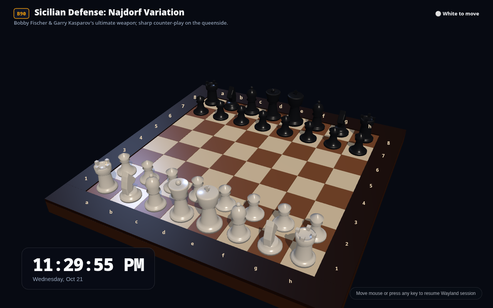
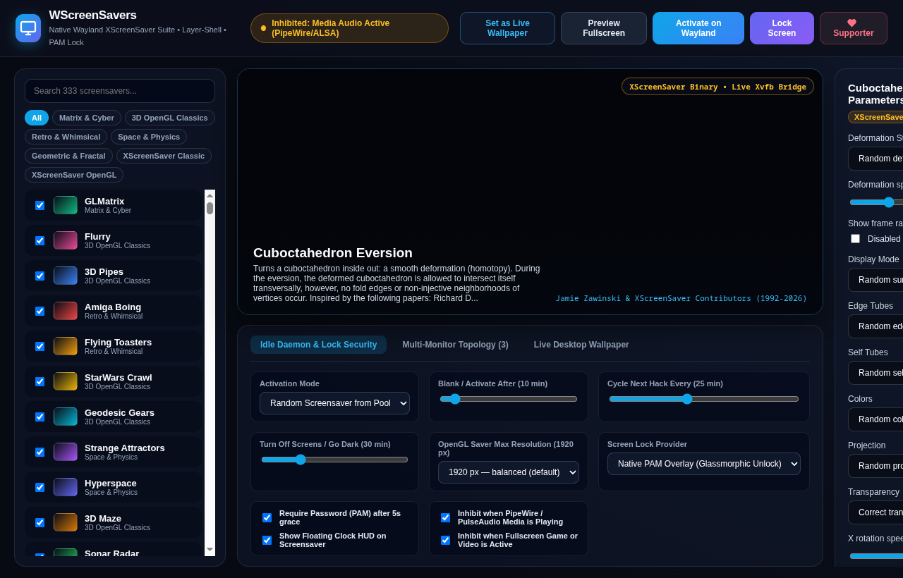
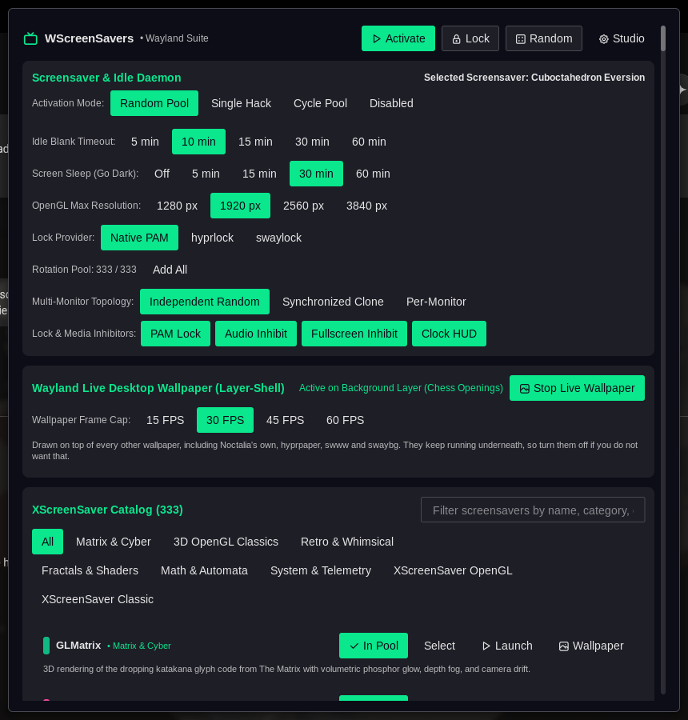

# WScreenSavers

<p align="center">
  
</p>

<p align="center">
  <a href="https://aur.archlinux.org/packages/wscreensavers"></a>
  <a href="https://github.com/chrisfair/wscreensavers/releases"></a>
  <a href="LICENSE"></a>
  <a href="https://wayland.freedesktop.org/"></a>
  <a href="https://github.com/chrisfair/wscreensavers/stargazers"></a>
</p>

<p align="center">
  <strong>The definitive native Wayland screensaver, PAM lock screen, and live desktop wallpaper suite.</strong><br />
  Brings Jamie Zawinski's legendary 330+ <strong>XScreenSaver</strong> hacks and modern hardware-accelerated 3D WebGL visualizers to Wayland compositors (Hyprland, Sway, River, Wayfire, and KDE).
</p>

---

## ⚡ Quick Install

### Arch Linux / Manjaro (AUR)
```bash
paru -S wscreensavers
# or
yay -S wscreensavers
```

### Build from Source
```bash
git clone https://github.com/chrisfair/wscreensavers.git
cd wscreensavers
make build
sudo make install
```

---

## 🌟 Why WScreenSavers?

For years, Wayland compositors lacked a native, lightweight screensaver solution. Classic XScreenSaver relied on X11 root-window hacks that do not work on Wayland.

**WScreenSavers** solves this cleanly using standard Wayland protocols (`zwlr_layer_shell_v1` and `ext-idle-notify-v1`):

- **Dual-Engine Flexibility**:
  - **Engine A (Native WebGL2/Canvas)**: 23 hand-crafted, hardware-accelerated visualizers with real-time UI parameter controls.
  - **Engine B (Universal XScreenSaver Bridge)**: Zero-overhead live stream bridge for all **310+** original `/usr/lib/xscreensaver/*` binaries (`endgame`, `anemone`, `glknots`, `sierpinski3d`, etc.) with full XML parameter parsing.
- **Wayland Live Desktop Wallpapers**: Turn any screensaver into an interactive, 60 FPS live animated background (`GTK_LAYER_SHELL_LAYER_BACKGROUND`) with configurable FPS caps.
- **Glassmorphic PAM Screen Lock**: Native Linux PAM password authentication or seamless plug-and-play handoff to `hyprlock` / `swaylock`.
- **Multi-Monitor Superpowers**:
  - **Independent Random**: Different screensaver on every monitor.
  - **Synchronized Clone**: Same hack running across all screens.
  - **Per-Monitor Pinning**: Set 3D Chess on your main monitor, GLMatrix on your vertical display, and Flurry on your secondary screen.
- **Smart Idle & Media Inhibition**: Automatically inhibits screen blanking when watching YouTube, Twitch, MPV, or VLC (via PipeWire/PulseAudio) or playing fullscreen games.
- **Noctalia Integration**: Includes an official Noctalia floating control deck and status bar widget.

---

## 📸 Screenshots & Showcase

| True 3D Chess Openings (endgame style) | Studio Control Center |
| :---: | :---: |
|  |  |

<p align="center">
  <strong>Noctalia Shell Control Deck</strong><br />
  
</p>

---

## 🎨 23 Native Hardware-Accelerated Visualizers

WScreenSavers includes 23 built-in WebGL2/Canvas visualizers with zero external dependencies:

1. **Chess Openings (3D)**: True 3D rendered grandmaster chess openings (Najdorf, Berlin, Queen's Gambit, King's Indian, etc.) with 3D Staunton pieces, specular board, parabolic lift arcs, and smooth camera orbit matching XScreenSaver's classic `endgame`.
2. **GLMatrix**: 3D Matrix katakana glyph digital rain with depth fog, volumetric glow, and camera drift.
3. **Flurry**: Multi-stream particle smoke plumes swirling around oscillating gravitational attractors.
4. **3D Pipes**: Self-building metallic plumbing networks with ball joints, 90° elbows, and Utah teapot Easter eggs.
5. **Amiga Boing**: 1984 Amiga 1000 red-and-white checkered bouncing sphere with purple room grid.
6. **Flying Toasters**: Winged chrome toasters and crispy toast slices soaring through the midnight sky.
7. **Star Wars Crawl**: Receding perspective opening text streaming live system logs or Unix lore.
8. **Geodesic Gears**: Interlocking 3D planetary gear assemblies with metallic specular highlights.
9. **Hyperspace**: Relativistic starfield warp drive tunnel with colorful nebula clouds.
10. **3D Maze**: First-person raycasted labyrinth with HUD minimap and brick wall textures.
11. **Sonar**: Tactical radar sweep plotting real LAN ARP network peers and active Linux processes.
12. **XAnalogTV**: Vintage CRT tube simulation with RF static, sync roll, and SMPTE color bars.
13. **BSOD**: Multi-OS crash screens (Windows NT, Linux Kernel Panic, Amiga Guru, Mac Sad Mac, TempleOS).
14. **Molecule**: 3D ball-and-stick molecular models (Caffeine, DNA, Buckminsterfullerene C60, Benzene).
15. **Phosphor**: Vintage P1 green or P3 amber teletype terminal typing live Linux telemetry.
16. **Strange Attractors**: Lorenz, Rössler, Aizawa, and Thomas chaotic dynamical systems.
17. **Mandelbrot & Julia**: Smooth continuous fractal zoom explorer with cycling palettes.
18. **Galaxy**: Colliding N-body spiral galactic arms with glowing dust cores.
19. **Game of Life**: Conway's cellular automaton with rainbow aging and glider genesis.
20. **Pyro**: Multi-stage aerial firework detonations with gravity particle physics.
21. **Epicycle**: Fourier harmonic epicycles drawing complex orbital curves.
22. **Rorschach**: Procedural inkblot symmetry patterns.
23. **Mystify**: Classic Windows 3.1 glowing bouncing polygons with color cycling trails.

---

## 🚀 Quickstart & Compositor Setup

### Hyprland (`~/.config/hypr/hyprland.conf`)

```ini
# Start the WScreenSavers idle daemon on login
exec-once = wscreensavers --daemon

# Keybinding to lock screen
bind = $mainMod, L, exec, wscreensavers --lock

# Keybinding to launch immediate screensaver preview
bind = $mainMod SHIFT, S, exec, wscreensavers --saver

# Keybinding to toggle live desktop wallpaper
bind = $mainMod ALT, W, exec, wscreensavers ctl wallpaper toggle
```

### Sway (`~/.config/sway/config`)

```ini
exec wscreensavers --daemon
bindsym $mod+l exec wscreensavers --lock
```

### CLI Controls (`wscreensavers ctl`)

WScreenSavers includes a CLI control tool for scripting and keybindings:

```bash
# Launch screensaver overlay
wscreensavers ctl launch

# Launch specific screensaver
wscreensavers ctl launch chessopenings

# Lock screen immediately
wscreensavers ctl lock

# Pick a random screensaver from the enabled pool and launch
wscreensavers ctl randomize launch

# Toggle live desktop wallpaper mode
wscreensavers ctl wallpaper toggle

# Enable all 330+ installed screensavers in rotation pool
wscreensavers ctl pool all

# Open the graphical Control Center Studio
wscreensavers ctl gui
```

---

## 🛠️ Building & Contributing

WScreenSavers is written in **Go** and **Vue 3 / Three.js**:

```bash
# Install build dependencies (Arch Linux)
sudo pacman -S --needed go nodejs npm gtk3 webkit2gtk-4.1 gtk-layer-shell pam xscreensaver xorg-server-xvfb ffmpeg

# Clone & Build
git clone https://github.com/chrisfair/wscreensavers.git
cd wscreensavers
make build

# Run Unit Tests with Coverage
make test
```

---

## 📜 License

WScreenSavers is open source licensed under the **GNU General Public License v3.0** ([`GPL-3.0-or-later`](LICENSE)).
All original XScreenSaver hacks are copyrighted by Jamie Zawinski and their respective authors.
